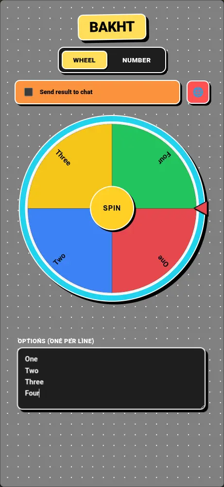

  

<h1 align="center">Bakht</h1>

**Bakht** (means "luck" in Persian) is a [webxdc](https://webxdc.org) app that runs inside **Delta Chat**, providing two methods for making random decisions:

- 🎡 **Spin wheel** — With animated acceleration and deceleration physics  
- 🎰 **Random number picker** — With a rolling “slot machine” animation  
- 📤 **Optional share results to the chat** — The options and winning result are posted as a webxdc update, so other chat members can open it and try the same options themselves  
- 🌐 **Multi-language support** — All UI text is managed through i18n files

## Screenshot

## Development

The app is plain HTML/CSS/JS with no build step. Open `index.html` directly in a browser to develop — `webxdc.js` provides a stub of the webxdc API so everything works outside Delta Chat (results are logged to the console instead of posted to a chat).

To test real chat integration, you have two options:
1. Run /git-assets/make-xdc.sh and it will create /temp/app.xdc
2. Package the app directory into a `.zip` archive, rename the extension to `.xdc`, and send it into any supported messenger(like DeltaChat).

### Adding a language

Add a new dictionary entry in `i18n.js` (copy the `en` block and translate the strings).
